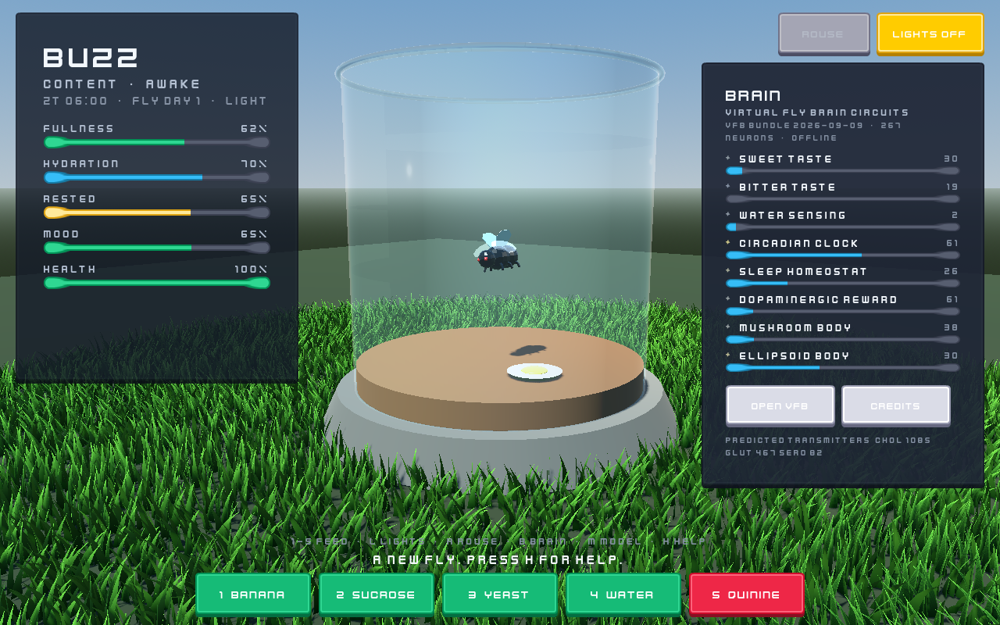

# PetFly

[](LICENSE)
[](https://github.com/eagnespuerto/pet-fly/releases/latest)
[](https://github.com/eagnespuerto/pet-fly)
[](https://ko-fi.com/eagnespuerto)
[](https://linktr.ee/soitsagnes)

A virtual pet fruit fly with a real *Drosophila* brain.

You feed it, put its lights on and off, and watch it sleep. What makes it more
than a Tamagotchi is that its hunger and sleep run on actual fly biology, and
the circuits driving that behaviour are real neuron populations from
[Virtual Fly Brain](https://virtualflybrain.org) — which the game can re-query
live while it runs.



## Download

Grab **`PetFly-win-Setup.exe`** from the
[latest release](../../releases/latest). It installs per-user with no admin
prompt and updates itself from then on. `PetFly-win-Portable.zip` is the same
game with no installer.

## Controls

| Key | Action |
|---|---|
| `1`–`5` | offer food (banana, sucrose, yeast, water, quinine) |
| `L` | toggle lights |
| `R` | rouse a sleeping fly |
| `B` | brain panel |
| `M` | swap fly model |
| `C` / `H` | credits / help |
| drag, wheel | orbit and zoom |

## Why the sleep is interesting

Sleep is not a countdown timer. It uses the two-process model that real fly
sleep research uses:

- **Process C** — circadian drive from the pacemaker (clock) neurons.
  *Drosophila* is crepuscular: active at dawn and dusk, a midday siesta, then
  consolidated night sleep.
- **Process S** — sleep pressure, gated by the dorsal fan-shaped body neurons.
  It builds while awake and discharges during sleep.

Simulated over three fly days, that reproduces a published fly sleep profile —
about 9.3 hours per fly day, with the siesta peaking at ZT7. Starving the pet
drops it to 2.2 hours, because hungry flies stay awake to forage. So feed it.

One real second is one fly minute, so a fly day passes in 24 real minutes. The
pet keeps living while the game is closed, up to 16 fly hours.

## Built with

[Summer Engine](https://summerengine.com) (Godot 4.7), packaged with
[Velopack](https://velopack.io). Brain data harvested from Virtual Fly Brain
through the [`vfb_connect`](https://github.com/VirtualFlyBrain/VFB_connect) API.

## Build it yourself

```powershell
pwsh tools\build.ps1
```

Exports the project and packages the installer, portable zip and update feed
into `dist\`. Needs Summer Engine and `dotnet tool install -g vpk`.

Headless tests:

```powershell
$s = "$env:LOCALAPPDATA\SummerEngine\current\Summer.exe"
& $s --headless --path . --script res://tests/sim_test.gd
```

[docs/DESIGN.md](docs/DESIGN.md) covers the architecture, the animation state
machine, the grass shader, and how the VFB integration works.

## Licence

Code is [MIT](LICENSE). Bundled assets keep their own licences — the fly models
are CC0 and CC-BY 3.0, the UI is Kenney's CC0 pack, and the brain data comes
from Virtual Fly Brain. See [CREDITS.md](CREDITS.md).
